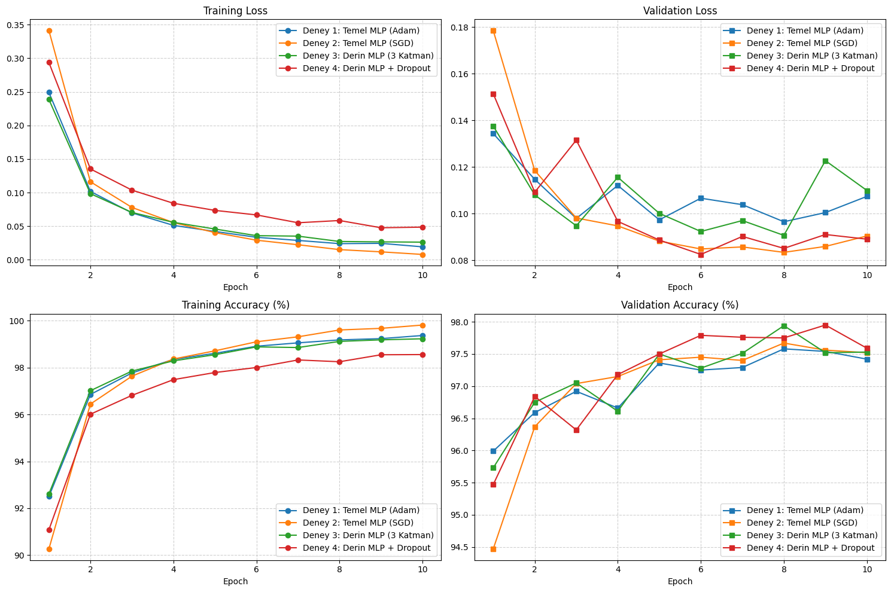
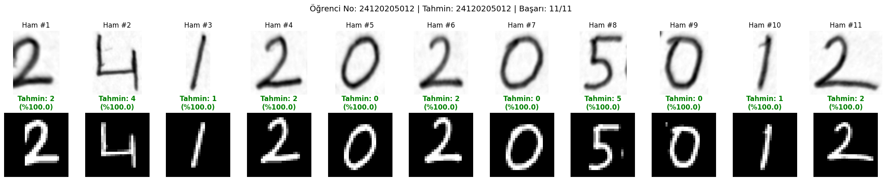

# BIL485 Derin Öğrenme — Ödev 1: MNIST ile MLP Eğitimi ve El Yazısı Testi

Bu ödevde CNN kullanmadan dört farklı MLP modeli eğittim. Katman yapısını, optimizer'ı ve Dropout kullanımını değiştirerek sonuçları karşılaştırdım. Daha sonra doğrulama başarısına göre seçtiğim modeli kendi el yazımla yazdığım öğrenci numaram (`24120205012`) üzerinde denedim.

## Deney Sonuçları

MNIST verisini 50.000 eğitim, 10.000 doğrulama ve 10.000 test görüntüsü olarak ayırdım. Tüm modelleri ReLU, `CrossEntropyLoss` ve `batch_size=64` kullanarak 10 epoch eğittim. Her modelin en iyi doğrulama sonucunu veren ağırlıklarını test kümesinde bir kez değerlendirdim.

| Model | Gizli katmanlar | Optimizer / LR | Dropout | En iyi Val Acc (%) | Test Acc (%) |
|---|---|---|---:|---:|---:|
| Temel MLP | `[256, 128]` | Adam / 0.001 | 0.0 | 97.58 | 97.85 |
| Temel MLP | `[256, 128]` | SGD / 0.010 | 0.0 | 97.67 | 97.84 |
| Derin MLP | `[512, 256, 128]` | Adam / 0.001 | 0.0 | 97.94 | 97.96 |
| Derin MLP + Dropout | `[512, 256, 128]` | Adam / 0.001 | 0.2 | **97.95** | **98.03** |

SGD'de `momentum=0.9` kullandım. Doğrulama başarısı en yüksek olan Dropout'lu modelin 9. epoch ağırlıklarını el yazısı testi için seçtim.

## Sonuçlar Hakkındaki Değerlendirmem

Adam ilk epoch'ta SGD'ye göre daha yüksek doğrulama başarısı verdi ama test sonuçları neredeyse aynı çıktı. SGD bu çalıştırmada yaklaşık 19 saniye daha hızlıydı. Öğrenme oranları da farklı olduğu için bu farkı sadece optimizer'a bağlayamam.

Derin modelde 8. epoch'tan sonra eğitim kaybı düşmeye devam ederken doğrulama kaybı yükseldi. Örneğin 8. ve 10. epoch arasında Train Loss `0.0272 → 0.0262` düşerken Val Loss `0.0907 → 0.1099` arttı. Bunu overfitting belirtisi olarak yorumladım. Katman sayısını artırmanın tek başına daha iyi sonuç almak için yeterli olmadığını gördüm; bu deneyde katman genişliklerini de değiştirmiştim.

Dropout eklediğim model, eğitim doğruluğu daha düşük olmasına rağmen en yüksek doğrulama ve test sonucunu verdi. Bu sonuç, Dropout'un modelin genellemesine yardımcı olabildiğini düşündürdü. Ancak derin modelle arasındaki doğrulama farkı sadece 0,01 yüzde puan olduğu için her zaman daha iyi olacağını söylemek için deneyleri tekrarlamak gerekir.

## Kendi El Yazımla Test

İlk denememde fotoğraftaki gölgeler ve kopuk çizgiler yüzünden rakamlar düzgün ayrılamadı. Aydınlatma farklarını azaltıp parçaları birleştirdikten sonra, numaranın 11 haneli olduğunu kullanarak rakam kutularını seçtim. Her rakamı oranını koruyarak küçülttüm, `28 × 28` görüntünün merkezine hizaladım ve MNIST ile aynı şekilde normalize ettim.

Gerçek numara: `24120205012` — Tahmin: `24120205012` — Başarı: 11/11

Bu çalışmada en çok dikkatimi çeken şey, fotoğrafı modele vermeden önce hazırlamanın sonucu ne kadar etkilediği oldu. MNIST ile telefon fotoğrafı arasında fark olduğu için rakamları temizlemek ve hizalamak önemliydi. Model bu fotoğraftaki bütün rakamları doğru bildi; ancak tek bir fotoğraftaki başarı, her el yazısında aynı sonucu alacağım anlamına gelmiyor. Görseldeki `%100.0` güven skorları da kesin doğruluk garantisi değil.

Genel olarak, CNN kullanmadan da MNIST üzerinde **%98,03 test doğruluğuna** ulaşabildim. Ödev sayesinde model yapısı kadar ön işlemenin ve doğrulama sonuçlarını takip etmenin de önemli olduğunu gördüm. Daha sağlam bir değerlendirme için farklı kişilerin el yazılarıyla test yapmak ve eğitimleri farklı rastgelelik tohumlarıyla tekrarlamak isterim.
